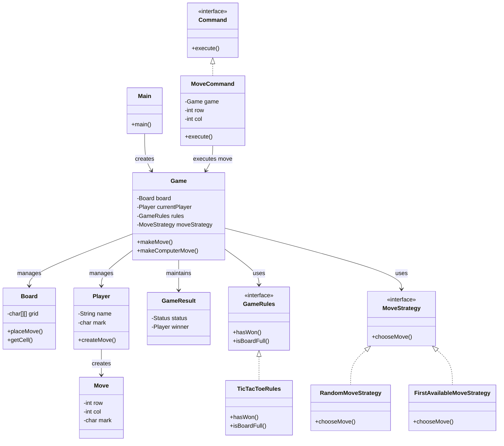

# 🎮 Turn-Based Game Engine — Tic-Tac-Toe

A beginner-friendly **Low-Level Design (LLD)** project built using plain Java.

This project demonstrates how to design a software system step by step, starting with a simple working implementation and gradually improving its structure using:

- Object-Oriented Programming (OOP)
- SOLID principles
- Design Patterns
- Code refactoring
- Code review and testing

The main goal is not to use as many design patterns as possible.

The goal is to understand **what problem a design principle or pattern solves, why it is needed, and how to introduce it into an existing implementation.**

This project is designed for beginners preparing for LLD interviews and software engineering placements.

---

## 📌 1. Project Overview

Tic-Tac-Toe is a turn-based game played on a 3 × 3 board.

Two players take turns placing their marks:

- Player 1 uses `X`
- Player 2 uses `O`

The first player to complete a row, column, or diagonal wins.

If the board becomes full without a winner, the game ends in a draw.

Although Tic-Tac-Toe is a small game, it contains several important software design problems:

- Managing objects and their state
- Separating responsibilities
- Validating user actions
- Managing the sequence of operations
- Detecting changes in system state
- Supporting different algorithms
- Representing actions as objects

These same problems appear in much larger software systems.

---

## 🛠️ 2. Technology Used

| Technology | Purpose |
|---|---|
| Java | Core programming language |
| OOP | Organizing the system using classes and objects |
| SOLID principles | Improving maintainability and extensibility |
| Design Patterns | Solving recurring design problems |
| Git | Tracking development stages |

This project uses **plain Java only**.

No Maven, Gradle, Spring Boot, database, or external libraries are required.

---

## 🏗️ 3. Architecture

The project follows a simple object-oriented architecture.



### Architecture explanation

- `Main` creates and starts the game.
- `Game` manages the game flow.
- `Board` stores the board state.
- `Player` represents a player.
- `Move` represents a player's move.
- `GameResult` represents the current game result.
- `GameRules` defines the rules contract.
- `TicTacToeRules` implements the rules.
- `MoveStrategy` defines how a move is selected.
- `RandomMoveStrategy` and `FirstAvailableMoveStrategy` provide different algorithms.
- `Command` defines an executable action.
- `MoveCommand` represents a move as an object.

The architecture is intentionally small so that the responsibilities and relationships can be understood easily.

---

# 📚 4. Development Stages

The project was developed incrementally.

Each stage introduces a small modification to the previous implementation.

Instead of adding all the design patterns at the beginning, we first built a working system and then improved its design.

## Stage 0 — Working Baseline

### What was developed?

We started with a simple implementation containing:

- `Board`
- `Main`

The board stores the marks placed by the players.

The main class creates the board and performs a sequence of moves.

### Why?

Before introducing design patterns, we need to understand the basic behavior of the system.

At this stage, we focused on:

- Representing the board
- Placing marks
- Displaying the board

### How did the code change?

We created a simple board representation using a two-dimensional character array.

```java
char[][] grid;
```

The board was initialized with empty cells.

### What did we learn?

A working baseline gives us something concrete to improve.

It is easier to understand the need for a design principle when we can see the problem in an existing implementation.

---

## Stage 1 — Single Responsibility Principle

### What changed?

We separated board data from board display.

We introduced:

- `Board`
- `BoardDisplay`

Previously, the board was responsible for both storing data and displaying it.

Now:

- `Board` manages the board state.
- `BoardDisplay` prints the board.

### Why?

Imagine that we later want to display the board using a graphical interface instead of the console.

If the board itself contains printing logic, changing the display may require modifying the board.

By separating these responsibilities, the board can remain unchanged while the display implementation changes.

### Principle introduced

**Single Responsibility Principle (SRP)**

A class should have one primary responsibility and one reason to change.

This does not mean a class should contain only one method.

It means its methods should belong to a clear responsibility.

### Placement takeaway

When a class is doing several unrelated things, ask:

"Can these responsibilities change independently?"

If the answer is yes, separating them may improve the design.

---

## Stage 2 — Encapsulation and the Move Object

### What changed?

We introduced the `Move` class.

Instead of passing row, column, and mark separately throughout the system, we represented a move as an object.

A move contains:

- Row
- Column
- Player mark

### Why?

Consider this method:

```java
placeMove(row, col, mark);
```

These three values together represent one meaningful concept.

By creating a `Move` object, we can represent that concept directly:

```java
Move move = new Move(0, 1, 'X');
```

The method becomes:

```java
placeMove(move);
```

### Principle introduced

**Encapsulation**

Encapsulation means keeping an object's data and related behavior together while controlling how its internal state is accessed.

In our implementation, the fields of `Move` are private and final.

This prevents other classes from directly modifying the move after it has been created.

### Placement takeaway

Whenever several values always travel together, consider whether they represent a meaningful object in the domain.

Examples:

- `Payment`
- `Booking`
- `OrderItem`
- `Transaction`
- `Move`

---

## Stage 3 — Introduce the Player Class

### What changed?

We introduced the `Player` class.

A player now contains:

- Name
- Mark

The player can also create a move using its own mark.

```java
player.createMove(0, 1);
```

This creates a move using the player's assigned mark.

### Why?

Previously, the game could directly work with marks such as `X` and `O`.

But a mark alone does not represent a complete player.

A player has identity and information associated with it.

By introducing `Player`, we avoid scattering player-related information throughout the system.

### OOP concept introduced

**Object Modeling**

Object modeling means identifying the important concepts in the problem domain and representing them as objects.

In this case:

- A board is an object.
- A player is an object.
- A move is an object.

### Placement takeaway

Don't create classes randomly.

Identify the important nouns in the problem statement, then decide which ones represent meaningful domain objects.

---

## Stage 4 — Represent the Game Result

### What changed?

We introduced `GameResult`.

The game can now represent three possible states:

```java
IN_PROGRESS
WIN
DRAW
```

We also introduced static factory methods:

```java
GameResult.inProgress();
GameResult.win(player);
GameResult.draw();
```

### Why?

Previously, the game might use separate variables to represent:

- Whether the game is over
- Whether someone won
- Whether the game ended in a draw
- Which player won

Using several independent variables can create inconsistent states.

By introducing `GameResult`, we represent the result as one meaningful object.

### Concepts introduced

- Enum
- Static factory methods
- Encapsulation
- Modeling system state

### Placement takeaway

When several variables describe one concept, consider grouping them into a single object.

This is useful for:

- Payment status
- Order status
- Booking status
- Authentication result
- Transaction result

---

## Stage 5 — Introduce the Game Class

### What changed?

We introduced the `Game` class.

It became responsible for managing the game flow.

The game now coordinates:

- The board
- The players
- The current player
- The game result
- Player switching

### Why?

Before this stage, the main class was responsible for performing many operations.

As the system grew, the main class would become difficult to maintain.

By introducing `Game`, we created a central object that manages the lifecycle of a game.

The `Main` class now primarily creates the objects and starts the application.

### Principle introduced

**Separation of Responsibilities**

The responsibilities are now distributed:

- `Board` manages board state.
- `Player` represents a player.
- `Move` represents an action.
- `GameResult` represents the result.
- `Game` manages the game flow.

### Placement takeaway

A class should not know everything about the system.

It should coordinate only the responsibilities that belong to it.

---

## Stage 6 — Separate Game Rules

### What changed?

We introduced:

```java
TicTacToeRules
```

This class contains the logic for:

- Checking whether a player has won
- Checking whether the board is full

### Why?

Initially, winner detection and draw detection were part of the game flow.

But these are separate responsibilities.

The game should manage the sequence of play, while the rules class should determine whether a particular board state represents a win or draw.

### Principle introduced

**Separation of Concerns**

Different parts of the system should handle different kinds of logic.

For example:

- Game flow is not the same as winner detection.
- Board display is not the same as board state.
- Move selection is not the same as move execution.

### Placement takeaway

When a class becomes difficult to understand because it contains several kinds of logic, consider extracting one responsibility into another class.

---

## Stage 7 — Open/Closed Principle

### What changed?

We introduced the `GameRules` interface.

```java
public interface GameRules {

    boolean hasWon(Board board, char mark);

    boolean isBoardFull(Board board);
}
```

Then:

```java
public class TicTacToeRules
        implements GameRules
```

The `Game` class now depends on the interface instead of directly depending on `TicTacToeRules`.

### Why?

Suppose we later want to create another game with different rules.

If `Game` directly depends on `TicTacToeRules`, we may need to modify the game class.

By introducing an interface, we can provide another implementation of the rules.

The game only needs to know that the rules object supports the required methods.

### Principle introduced

**Open/Closed Principle (OCP)**

Software entities should be open for extension but closed for modification.

In simple words:

> We should be able to add new behavior without unnecessarily changing existing working code.

### Design concept introduced

**Dependency Injection**

Instead of creating the rules object inside `Game`, we pass it through the constructor.

```java
Game game = new Game(
        "Player 1",
        "Player 2",
        rules,
        strategy
);
```

The game receives its dependency from outside.

### Placement takeaway

Use interfaces when you have a genuine need for interchangeable implementations.

Do not create interfaces for every class automatically.

---

## Stage 8 — Strategy Pattern

### What changed?

We introduced:

- `MoveStrategy`
- `RandomMoveStrategy`
- `FirstAvailableMoveStrategy`

The game no longer needs to know how the computer selects a move.

It simply asks the strategy to choose one.

### Why?

Imagine that we want to support different computer players:

- A random computer
- A computer that chooses the first available cell
- A computer that tries to win
- A computer that blocks the opponent

If all the algorithms were written directly inside `Game`, the game class would become increasingly complicated.

Instead, we encapsulated the move-selection algorithm inside a strategy.

### Pattern introduced

**Strategy Pattern**

The Strategy Pattern allows us to define a family of algorithms, encapsulate each one, and make them interchangeable.

### Example

```java
MoveStrategy strategy =
        new RandomMoveStrategy();
```

We can replace it with:

```java
MoveStrategy strategy =
        new FirstAvailableMoveStrategy();
```

The game class does not need to change.

### Placement takeaway

When a system needs to support multiple ways of performing the same task, consider the Strategy Pattern.

Examples:

- Different payment methods
- Different pricing algorithms
- Different route-planning algorithms
- Different notification methods
- Different sorting algorithms

---

## Stage 9 — Command Pattern

### What changed?

We introduced:

- `Command`
- `MoveCommand`

Previously, a move was directly executed:

```java
game.makeMove(0, 0);
```

Now the move can be represented as a command object:

```java
Command command =
        new MoveCommand(game, 0, 0);

command.execute();
```

### Why?

Representing an action as an object gives us additional flexibility.

A command can be:

- Stored
- Executed later
- Added to a history
- Passed to another object

This creates a foundation for features such as undo, redo, and replay.

### Pattern introduced

**Command Pattern**

The Command Pattern encapsulates a request as an object.

In our implementation:

- `Command` defines the common interface.
- `MoveCommand` stores the details of a move.
- `Game` performs the actual game logic.

### Important limitation

The current implementation represents and executes moves as commands.

It does **not** yet implement undo or redo.

Those features require additional work to store and restore the previous state of the game.

### Placement takeaway

When actions need to be stored, queued, logged, replayed, or reversed, consider whether representing them as objects would help.

---

# 📁 5. Final Project Structure

```text
turn-based-game-engine/
│
└── src/
    ├── Board.java
    ├── BoardDisplay.java
    ├── Move.java
    ├── Player.java
    ├── GameResult.java
    ├── GameRules.java
    ├── TicTacToeRules.java
    ├── MoveStrategy.java
    ├── RandomMoveStrategy.java
    ├── FirstAvailableMoveStrategy.java
    ├── Command.java
    ├── MoveCommand.java
    ├── Game.java
    └── Main.java
```

Each class has a clear role in the system.

The project is intentionally kept small so that the design can be understood without requiring a large framework or complex infrastructure.

---

# ▶️ 6. How to Run the Project

Make sure Java is installed.

Check the Java version:

```bash
java -version
javac -version
```

Navigate to the source directory:

```bash
cd src
```

Compile all Java files:

```bash
javac *.java
```

Run the application:

```bash
java Main
```

No external dependencies are required.

---

# 🧠 7. Design Principles and Patterns Used

| Principle or Pattern | Where it was applied |
|---|---|
| Single Responsibility Principle | Separating board display and game rules |
| Encapsulation | Private fields in domain objects |
| Object Modeling | Board, Player, Move, GameResult |
| Separation of Concerns | Game flow separated from rules and display |
| Open/Closed Principle | GameRules interface |
| Dependency Injection | Passing rules and strategy into Game |
| Strategy Pattern | Interchangeable move-selection algorithms |
| Command Pattern | Representing a move as an executable object |

These concepts were introduced gradually because each one solved a specific design problem.

---

# 🚧 8. What Is Not Implemented Yet?

This project focuses on the core design of a Tic-Tac-Toe engine.

The following features are intentionally left for future improvements:

- Undo and redo
- Advanced AI
- Graphical user interface
- Persistent game history
- Multiplayer networking
- Game event system

Not every project needs every pattern or feature.

The purpose of this project is to learn how to make design decisions based on the requirements.

---

# 🔍 9. Recommended Next Stage — Code Review and Testing

Before adding any more design patterns, the next step should be a complete code review and testing stage.

A project is not complete simply because it compiles and produces the expected output for one example.

We should verify that the system behaves correctly in different situations.

## A. Code Review

Review each class and ask the following questions.

### Responsibility

- Does this class have a clear purpose?
- Is it doing unrelated work?
- Can some logic be moved into a more appropriate class?

### Encapsulation

- Are fields unnecessarily public?
- Can an object enter an invalid state?
- Are objects responsible for protecting their own data?

### Dependencies

- Does a class depend on a concrete implementation unnecessarily?
- Would an interface provide useful flexibility?
- Are we introducing abstractions without a real need?

### Design Patterns

- Does the pattern solve an actual problem?
- Is the pattern making the code easier to understand?
- Could a simpler implementation work just as well?

### Maintainability

- Are method names meaningful?
- Is the code easy to follow?
- Is there duplicated logic?
- Can the code be explained clearly in an interview?

---

## B. Testing

The game should be tested against several scenarios.

### Board tests

- Place a mark in an empty cell.
- Try placing a mark in an occupied cell.
- Try placing a mark outside the board.
- Verify that the board state remains unchanged after an invalid move.

### Game tests

- Verify that players alternate correctly.
- Verify that a player wins after completing a row.
- Verify that a player wins after completing a column.
- Verify that a player wins after completing a diagonal.
- Verify that a full board without a winner results in a draw.
- Verify that no moves are accepted after the game ends.

### Strategy tests

- Verify that the random strategy chooses only empty cells.
- Verify that the first-available strategy chooses the expected empty cell.
- Verify that the game works when a different strategy is injected.

### Command tests

- Verify that executing a valid move command changes the board.
- Verify that an invalid command does not corrupt the game state.
- Verify that commands use the same game validation logic as direct moves.

These tests help us identify whether the design is correct, not just whether the application runs.

---

# 💡 10. A Reusable LLD Development Method

The most valuable learning from this project is not Tic-Tac-Toe itself.

It is the development method.

The same approach can be applied to other LLD interview problems.

## Step 1 — Understand the Requirements

Before writing code, identify:

- What the system should do
- Who interacts with the system
- What the important use cases are
- What rules must be enforced
- What is outside the scope

For example, in a Parking Lot system:

- Vehicles enter and exit.
- Parking spots are assigned.
- Tickets are generated.
- Fees are calculated.

Do not immediately start creating design patterns.

First understand the behavior.

## Step 2 — Identify the Domain Objects

Look for meaningful concepts in the problem.

For a Parking Lot system:

```text
ParkingLot
ParkingFloor
ParkingSpot
Vehicle
Ticket
Payment
```

For a Library Management system:

```text
Library
Book
BookCopy
Member
Loan
Reservation
```

These objects form the initial model of the system.

## Step 3 — Build the Simplest Working Version

Implement the core functionality using simple classes and methods.

At this stage:

- Avoid unnecessary interfaces.
- Avoid adding patterns prematurely.
- Keep the implementation easy to understand.
- Make sure the main use cases work.

The goal is to create a working baseline.

## Step 4 — Identify Design Problems

Once the baseline works, review the code.

Ask:

- Is one class doing too many things?
- Is the same logic duplicated?
- Is a class tightly coupled to another class?
- Is a method difficult to understand?
- Will a likely requirement change force us to modify many classes?

These questions help identify where refactoring is useful.

## Step 5 — Introduce Principles Before Patterns

Start with basic design principles.

For example:

- SRP: Separate responsibilities.
- Encapsulation: Protect object state.
- OCP: Allow useful extensions.
- Dependency Inversion: Depend on abstractions where appropriate.

Design patterns are often practical ways to apply these principles.

## Step 6 — Introduce a Pattern Only When Needed

Use a pattern to solve a specific problem.

| Problem | Possible pattern |
|---|---|
| Multiple interchangeable algorithms | Strategy |
| Actions need to be represented as objects | Command |
| Objects need to be notified about events | Observer |
| Object creation is becoming complicated | Factory |
| Several objects need a coordinated workflow | Facade or another suitable pattern |

These are examples, not mandatory steps.

A system may need only one pattern—or none at all.

## Step 7 — Review and Test After Each Change

After introducing a new abstraction or pattern:

1. Compile the project.
2. Run the existing use cases.
3. Test the new behavior.
4. Check whether old behavior still works.
5. Review whether the code became easier or harder to understand.

This prevents design changes from silently breaking working functionality.

## Step 8 — Stop When the Design Is Good Enough

A good LLD design is not the design with the most classes.

It is the design that:

- Meets the requirements
- Is easy to understand
- Maintains correct behavior
- Separates responsibilities appropriately
- Can handle expected changes without unnecessary complexity

**Avoid overengineering.**

If a simple class solves the problem clearly, use the simple class.

---

# 🎯 11. Applying This Method in LLD Placements

During an LLD interview, you can follow this sequence:

1. Clarify the requirements.
2. Identify the main use cases.
3. Identify the domain objects.
4. Define the responsibilities of each class.
5. Establish relationships between classes.
6. Implement the core flow.
7. Identify likely extension points.
8. Introduce suitable interfaces or patterns.
9. Explain trade-offs.
10. Review edge cases and testing.

For example, if the interviewer asks you to design a Parking Lot:

Do not begin by saying:

"I will use Factory, Strategy, Observer, and Singleton."

Instead, begin by understanding how the parking lot works.

Then build the design.

If fee calculation needs multiple algorithms, Strategy may be useful.

If parking operations need to be recorded and reversed, Command may be useful.

If the system needs to notify several components when a spot becomes available, Observer may be useful.

The requirement should determine the design—not the other way around.

---

## 🏁 Final Takeaway

This project demonstrates an important approach to software design:

**Start simple → Make it work → Identify design problems → Refactor → Introduce patterns when needed → Review and test.**

The same method can be applied to almost any LLD problem.

A strong software engineer is not someone who uses every design pattern.

A strong software engineer is someone who understands **when a pattern is useful, when it is unnecessary, and how to keep the design simple while meeting the requirements.**
